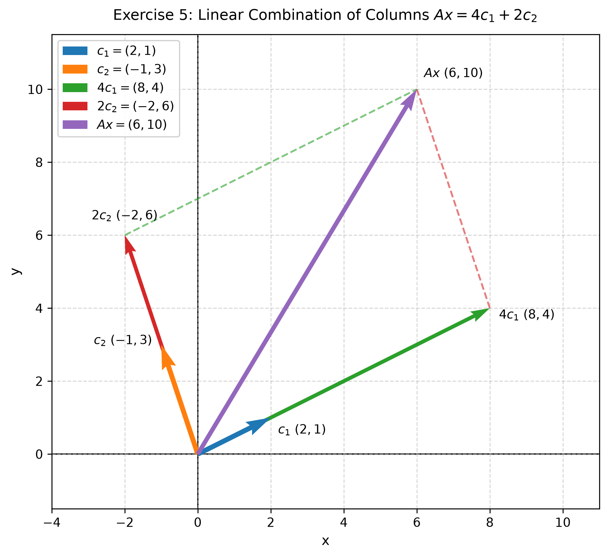

# Exercise 5. Matrix Times Vector

### Essential Formulas

**Matrix-Vector Multiplication:**

For a matrix $A$ and a column vector $x$, each entry of $Ax$ is calculated by multiplying one row of $A$ by the vector $x$ and adding the products.

For a $2 \times 2$ matrix and a $2 \times 1$ vector,

$$
A =
\begin{pmatrix}
a & b \\
c & d \\
\end{pmatrix},
\qquad
x =
\begin{pmatrix}
x_1 \\
x_2 \\
\end{pmatrix}
$$

the product is

$$
Ax =
\begin{pmatrix}
a x_1 + b x_2 \\
c x_1 + d x_2 \\
\end{pmatrix}.
$$

**Linear Combination of Columns:**

If the columns of $A$ are $c_1$ and $c_2$, then

$$
Ax = x_1 c_1 + x_2 c_2.
$$

The entries of the vector $x$ are the coefficients of the corresponding columns.

---

### Problem Statement

**Exercise 5. Matrix Times Vector**

Let

$$
A =
\begin{pmatrix}
2 & -1 \\
1 & 3 \\
\end{pmatrix},
\qquad
x =
\begin{pmatrix}
4 \\
2 \\
\end{pmatrix}.
$$

Compute $Ax$. Then express $Ax$ as a linear combination of the columns of $A$, with coefficients coming from the vector $x$.

> **Why this exercise:** shows that multiplying a matrix by a vector can be understood as a linear combination of the matrix columns.

---

### Solution

**Step 1: Compute $Ax$**

Multiply each row of matrix $A$ by the column vector $x$:

$$
Ax =
\begin{pmatrix}
2 & -1 \\
1 & 3 \\
\end{pmatrix}
\begin{pmatrix}
4 \\
2 \\
\end{pmatrix}
$$

Calculate each entry:

$$
Ax =
\begin{pmatrix}
(2 \cdot 4) + (-1 \cdot 2) \\
(1 \cdot 4) + (3 \cdot 2) \\
\end{pmatrix}
$$

Simplify:

$$
Ax =
\begin{pmatrix}
8 - 2 \\
4 + 6 \\
\end{pmatrix}
$$

Therefore,

$$
Ax =
\begin{pmatrix}
6 \\
10 \\
\end{pmatrix}.
$$

**Step 2: Express $Ax$ as a linear combination of the columns of $A$**

The columns of matrix $A$ are

$$
c_1 =
\begin{pmatrix}
2 \\
1 \\
\end{pmatrix},
\qquad
c_2 =
\begin{pmatrix}
-1 \\
3 \\
\end{pmatrix}.
$$

The entries of vector $x$ are $x_1 = 4$ and $x_2 = 2$. Therefore,

$$
Ax = 4c_1 + 2c_2.
$$

Substitute the columns:

$$
Ax = 4
\begin{pmatrix}
2 \\
1 \\
\end{pmatrix}
+ 2
\begin{pmatrix}
-1 \\
3 \\
\end{pmatrix}
$$

### Verification

Multiply each column by its coefficient:

$$
4
\begin{pmatrix}
2 \\
1 \\
\end{pmatrix}
=
\begin{pmatrix}
8 \\
4 \\
\end{pmatrix},
\qquad
2
\begin{pmatrix}
-1 \\
3 \\
\end{pmatrix}
=
\begin{pmatrix}
-2 \\
6 \\
\end{pmatrix}
$$

Add the resulting vectors:

$$
\begin{pmatrix}
8 \\
4 \\
\end{pmatrix}
+
\begin{pmatrix}
-2 \\
6 \\
\end{pmatrix}
=
\begin{pmatrix}
6 \\
10 \\
\end{pmatrix}
$$

This matches the result from Step 1.

### Final Answer

$$
Ax =
\begin{pmatrix}
6 \\
10 \\
\end{pmatrix}.
$$

As a linear combination of the columns of $A$,

$$
Ax = 4c_1 + 2c_2.
$$

