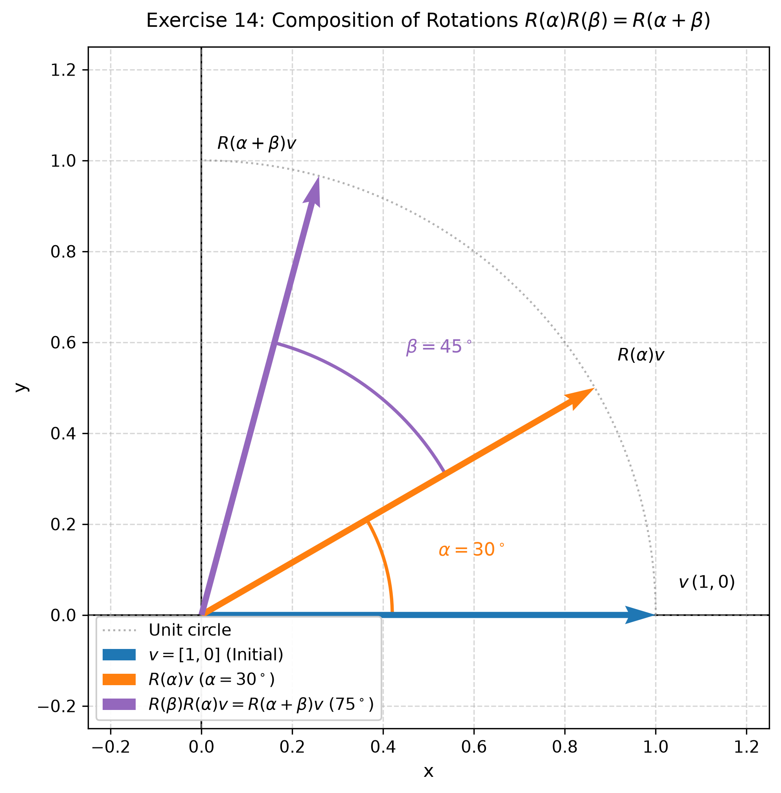

### Essential Formulas

**Trigonometric Angle-Sum Identities:**
The angle-sum identities for sine and cosine are:

$$
\cos(\alpha + \beta) = \cos\alpha \cos\beta - \sin\alpha \sin\beta
$$

$$
\sin(\alpha + \beta) = \sin\alpha \cos\beta + \cos\alpha \sin\beta
$$

**Rotation Matrix:**
A rotation matrix $R(\theta)$ rotates a vector in $\mathbb{R}^2$ by an angle $\theta$ counterclockwise about the origin:

$$
R(\theta) = \begin{pmatrix}
\cos\theta & -\sin\theta \\
\sin\theta & \cos\theta \\
\end{pmatrix}
$$

---

### Problem Statement

**Exercise 14. Rotation Matrices**

The matrix for a rotation through an angle $\theta$ is

$$
R(\theta) = \begin{pmatrix}
\cos\theta & -\sin\theta \\
\sin\theta & \cos\theta \\
\end{pmatrix}
$$

Compute $R(\alpha)R(\beta)$ and, using the angle-sum formulas for sine and cosine, show that

$$
R(\alpha)R(\beta) = R(\alpha+\beta)
$$

Explain the result geometrically.

> **Why this exercise:** shows the consistency between matrix algebra and the geometry of composing rotations.

---

### Solution

**Step 1: Compute the matrix product $R(\alpha)R(\beta)$**

Multiply the two rotation matrices:

$$
\begin{aligned}
R(\alpha)R(\beta) &= \begin{pmatrix}
\cos\alpha & -\sin\alpha \\
\sin\alpha & \cos\alpha \\
\end{pmatrix}
\begin{pmatrix}
\cos\beta & -\sin\beta \\
\sin\beta & \cos\beta \\
\end{pmatrix} \\
&= \begin{pmatrix}
\cos\alpha \cos\beta - \sin\alpha \sin\beta & -\cos\alpha \sin\beta - \sin\alpha \cos\beta \\
\sin\alpha \cos\beta + \cos\alpha \sin\beta & -\sin\alpha \sin\beta + \cos\alpha \cos\beta \\
\end{pmatrix}
\end{aligned}
$$

**Step 2: Apply the angle-sum formulas**

Substitute the trigonometric identities into the four matrix entries:
* **Top-left:** $\cos\alpha \cos\beta - \sin\alpha \sin\beta = \cos(\alpha + \beta)$
* **Top-right:** $-\cos\alpha \sin\beta - \sin\alpha \cos\beta = -(\sin\alpha \cos\beta + \cos\alpha \sin\beta) = -\sin(\alpha + \beta)$
* **Bottom-left:** $\sin\alpha \cos\beta + \cos\alpha \sin\beta = \sin(\alpha + \beta)$
* **Bottom-right:** $-\sin\alpha \sin\beta + \cos\alpha \cos\beta = \cos\alpha \cos\beta - \sin\alpha \sin\beta = \cos(\alpha + \beta)$

Substituting these expressions into the product yields:

$$
R(\alpha)R(\beta) = \begin{pmatrix}
\cos(\alpha + \beta) & -\sin(\alpha + \beta) \\
\sin(\alpha + \beta) & \cos(\alpha + \beta) \\
\end{pmatrix}
$$

**Step 3: Verify the equality**

By the definition of $R(\theta)$ with $\theta = \alpha + \beta$:

$$
R(\alpha+\beta) = \begin{pmatrix}
\cos(\alpha + \beta) & -\sin(\alpha + \beta) \\
\sin(\alpha + \beta) & \cos(\alpha + \beta) \\
\end{pmatrix}
$$

Therefore:

$$
R(\alpha)R(\beta) = R(\alpha+\beta)
$$

**Step 4: Geometric Explanation**

Matrix multiplication corresponds to the composition of linear transformations. 

Multiplying a vector by $R(\beta)$ rotates it counterclockwise by an angle $\beta$. Multiplying the resulting vector by $R(\alpha)$ rotates it further by an angle $\alpha$. 

Successively rotating a vector by $\beta$ and then by $\alpha$ is geometrically identical to a single rotation through the sum of the angles $\alpha + \beta$. The matrix product confirms this equivalence algebraically.

---

### Final Answer

$$
R(\alpha)R(\beta) = \begin{pmatrix}
\cos(\alpha + \beta) & -\sin(\alpha + \beta) \\
\sin(\alpha + \beta) & \cos(\alpha + \beta) \\
\end{pmatrix}
= R(\alpha + \beta)
$$
