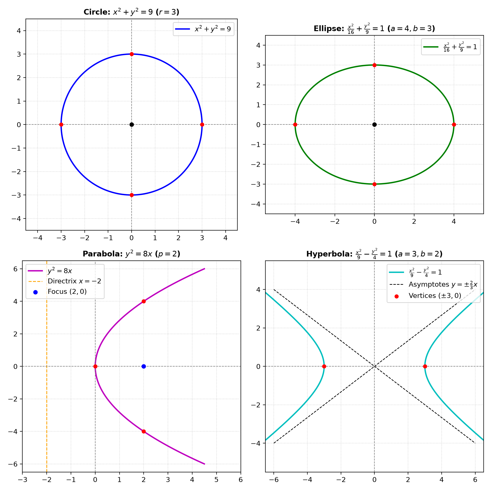

### Problem Statement

Recognize the curves

$$
x^2+y^2=9,
$$

$$
\frac{x^2}{16}+\frac{y^2}{9}=1,
$$

$$
y^2=8x,
$$

$$
\frac{x^2}{9}-\frac{y^2}{4}=1.
$$

For each one, identify the most important features and make a sketch. Explain which parts of the equation let you recognize the type of curve.

> **Why this exercise:** builds the basic dictionary: canonical equation → type of curve → shape and scale.

---

### Solution

#### Essential Formulas

1. **Canonical Equations of Second-Degree Plane Curves (Conic Sections):**
   * **Circle:**

     $$
     x^2 + y^2 = R^2
     $$

     Centered at $(0, 0)$ with radius $R > 0$. Characterized by equal positive coefficients for $x^2$ and $y^2$.

   * **Ellipse:**

     $$
     \frac{x^2}{a^2} + \frac{y^2}{b^2} = 1
     $$

     Centered at $(0, 0)$ with semiaxes $a > 0$ and $b > 0$. Characterized by positive unequal coefficients for $x^2$ and $y^2$.

   * **Parabola:**

     $$
     y^2 = 2px, \qquad x^2 = 2py
     $$

     Vertex at $(0, 0)$. Characterized by one variable being quadratic and the other linear.

   * **Hyperbola:**

     $$
     \frac{x^2}{a^2} - \frac{y^2}{b^2} = 1
     $$

     Centered at $(0, 0)$ with real semiaxis $a$ and imaginary semiaxis $b$. Characterized by quadratic terms having opposite algebraic signs ($+ / -$). Its asymptotes are:

     $$
     y = \pm \frac{b}{a} x
     $$

---

**Step 1: Analyze Curve 1: $x^2 + y^2 = 9$**

* **Recognition:**
  Both $x$ and $y$ appear as squared terms with equal positive coefficients ($1$), and the constant on the right-hand side is positive ($9 > 0$). This is the canonical equation of a **circle**.

* **Key Features:**
  - Center: $C(0, 0)$
  - Radius: $R = \sqrt{9} = 3$
  - Intercepts with axes: $(3, 0), (-3, 0), (0, 3), (0, -3)$
  - Domain and Range: $x \in [-3, 3]$, $y \in [-3, 3]$

* **Geometric Sketch Description:**
  A perfectly symmetric closed circular curve in the $xy$-plane centered at the origin $(0, 0)$ passing through $(3, 0)$, $(0, 3)$, $(-3, 0)$, and $(0, -3)$.

---

**Step 2: Analyze Curve 2: $\frac{x^2}{16} + \frac{y^2}{9} = 1$**

* **Recognition:**
  Both variables appear to the second power with positive, but unequal, denominators ($16 \neq 9$), summed to equal $+1$. This is the canonical equation of an **ellipse**.

* **Key Features:**
  - Center: $C(0, 0)$
  - Semiaxes: $a^2 = 16 \implies a = 4$ (horizontal semi-major axis), $b^2 = 9 \implies b = 3$ (vertical semi-minor axis)
  - Intercepts: $(\pm 4, 0)$ on the $x$-axis, $(0, \pm 3)$ on the $y$-axis
  - Focal distance:

    $$
    c = \sqrt{a^2 - b^2} = \sqrt{16 - 9} = \sqrt{7} \approx 2.65
    $$

  - Foci: $F_1(-\sqrt{7}, 0)$ and $F_2(\sqrt{7}, 0)$ on the $x$-axis

* **Geometric Sketch Description:**
  A smooth oval elongated horizontally along the $x$-axis, reaching wider from $-4$ to $4$ than its vertical height from $-3$ to $3$.

---

**Step 3: Analyze Curve 3: $y^2 = 8x$**

* **Recognition:**
  Only one variable is squared ($y^2$), while the other variable appears linearly ($x$). This asymmetry between powers is the definitive algebraic signature of a **parabola**.

* **Key Features:**
  - Vertex: $V(0, 0)$
  - Axis of symmetry: the $x$-axis ($y = 0$)
  - Opening direction: Since $y^2 \ge 0$, we must have $8x \ge 0 \implies x \ge 0$. The parabola opens to the **right**.
  - Parameter: $2p = 8 \implies p = 4$, so focal length is $p/2 = 2$.
  - Focus: $F(2, 0)$
  - Directrix: $x = -2$
  - Sample points: For $x = 2$, $y^2 = 16 \implies y = \pm 4$, yielding points $(2, 4)$ and $(2, -4)$.

* **Geometric Sketch Description:**
  An open U-shaped curve with its vertex at $(0, 0)$, opening toward the positive $x$-direction, symmetric across the horizontal axis.

---

**Step 4: Analyze Curve 4: $\frac{x^2}{9} - \frac{y^2}{4} = 1$**

* **Recognition:**
  Both variables are squared, but their terms have **opposite algebraic signs** (positive before $x^2$, negative before $y^2$), set equal to $+1$. This is the canonical equation of a **hyperbola**.

* **Key Features:**
  - Center: $C(0, 0)$
  - Transverse (real) axis: along the $x$-axis (since the $x^2$ term is positive)
  - Real semiaxis: $a^2 = 9 \implies a = 3$
  - Imaginary semiaxis: $b^2 = 4 \implies b = 2$
  - Vertices: $V_1(-3, 0)$ and $V_2(3, 0)$
  - Intercepts with $y$-axis: setting $x = 0$ gives $-y^2/4 = 1 \implies y^2 = -4$ (no real intersections)
  - Asymptotes: obtained by replacing $1$ with $0$:

    $$
    \frac{x^2}{9} - \frac{y^2}{4} = 0 \implies y = \pm \frac{2}{3} x
    $$

  - Focal distance:

    $$
    c = \sqrt{a^2 + b^2} = \sqrt{9 + 4} = \sqrt{13} \approx 3.61
    $$

  - Foci: $F_{1,2}(\pm\sqrt{13}, 0)$

* **Geometric Sketch Description:**
  Two separate symmetric open branches opening to the left ($x \le -3$) and to the right ($x \ge 3$), approaching the asymptote lines $y = \pm \frac{2}{3}x$ as $|x| \to \infty$.

---

**Step 5: Visual Sketches of the Four Curves**

The four canonical curves with their principal geometric features, axes of symmetry, intercepts, and asymptotes are plotted below:

---

### Final Answer

1. **Curve 1 ($x^2 + y^2 = 9$):**
   * **Type:** Circle
   * **Recognizing Feature:** Both variables are squared with identical positive coefficients ($1$).
   * **Characteristics:** Center $(0, 0)$, radius $R = 3$.

2. **Curve 2 ($\frac{x^2}{16} + \frac{y^2}{9} = 1$):**
   * **Type:** Ellipse
   * **Recognizing Feature:** Both variables are squared with positive, unequal denominators ($16 \neq 9$).
   * **Characteristics:** Center $(0, 0)$, horizontal semi-major axis $a = 4$, vertical semi-minor axis $b = 3$.

3. **Curve 3 ($y^2 = 8x$):**
   * **Type:** Parabola
   * **Recognizing Feature:** Exactly one variable is squared ($y^2$) while the other is linear ($x$).
   * **Characteristics:** Vertex $(0, 0)$, axis of symmetry $y = 0$, opens to the right ($x \ge 0$).

4. **Curve 4 ($\frac{x^2}{9} - \frac{y^2}{4} = 1$):**
   * **Type:** Hyperbola
   * **Recognizing Feature:** Both variables are squared with opposite signs ($+$ for $x^2$, $-$ for $y^2$).
   * **Characteristics:** Center $(0, 0)$, vertices $(\pm 3, 0)$, asymptotes $y = \pm \frac{2}{3}x$.
