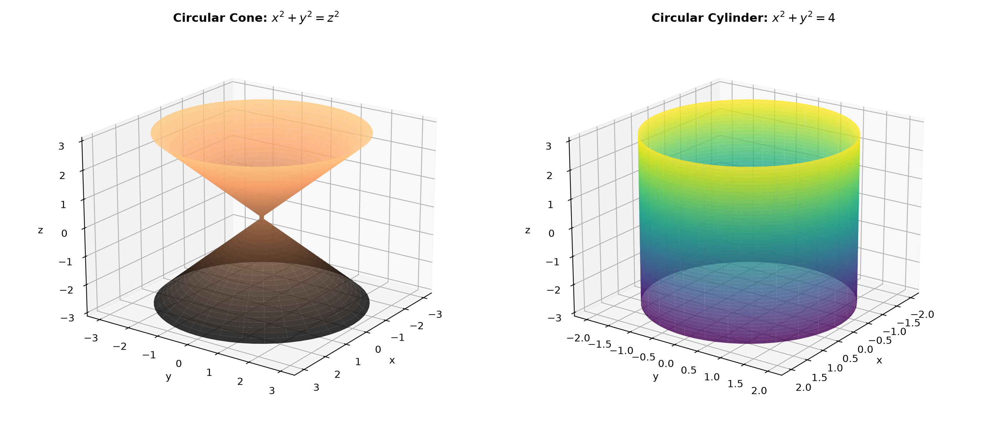

### Problem Statement

Compare

$$
x^2+y^2=z^2
$$

and

$$
x^2+y^2=4.
$$

For each surface, describe the cross-sections $z=c$, $x=0$, and $y=0$, make a sketch, and explain why the radius of the cross-section depends on $z$ in the first case but is constant in the second.

> **Why this exercise:** teaches how to distinguish a cone from a cylinder by the behavior of their cross-sections.

---

### Solution

#### Essential Formulas

1. **Equation of a Right Circular Cone (Double Cone):**

   $$
   x^2 + y^2 = z^2
   $$

   Apex at $(0, 0, 0)$ with axis of symmetry along the $z$-axis. Horizontal cross-sections are circles whose radius varies linearly with altitude:

   $$
   R(z) = |z|
   $$

2. **Equation of a Right Circular Cylinder:**

   $$
   x^2 + y^2 = R^2
   $$

   Axis of symmetry along the $z$-axis. Because the variable $z$ does not appear in the equation, the surface is generated by translating a circle of fixed radius $R$ infinitely along the $z$-axis.

3. **Absence of a Coordinate in 3D Equations:**
   When an equation in $\mathbb{R}^3$ does not contain a variable (such as $z$ in $x^2 + y^2 = 4$), the locus is a **cylindrical surface** whose ruling lines are parallel to the axis of the missing variable.

---

**Step 1: Cross-Section Analysis of Surface 1: $x^2 + y^2 = z^2$ (Double Cone)**

1. **Horizontal cross-sections $z = c$:**
   Substitute $z = c$:

   $$
   x^2 + y^2 = c^2
   $$

   * **For $c \neq 0$:** This is a **circle** in the plane $z = c$ centered at $(0, 0, c)$ with radius:

     $$
     R(c) = \sqrt{c^2} = |c|
     $$

   * **For $c = 0$:** $x^2 + y^2 = 0 \implies (x, y) = (0, 0)$, which is a **single point** (the apex of the cone at $(0, 0, 0)$).

2. **Vertical cross-section $x = 0$ ($yz$-plane trace):**
   Substitute $x = 0$:

   $$
   y^2 = z^2 \implies y^2 - z^2 = 0 \implies (y - z)(y + z) = 0
   $$

   $$
   z = y, \qquad z = -y
   $$

   This is a pair of **intersecting straight lines** passing through the origin with slopes $\pm 1$.

3. **Vertical cross-section $y = 0$ ($xz$-plane trace):**
   Substitute $y = 0$:

   $$
   x^2 = z^2 \implies z = \pm x
   $$

   This is a pair of **intersecting straight lines** passing through the origin with slopes $\pm 1$.

4. **Qualitative Sketch Description:**
   A double-napped cone meeting tip-to-tip at the origin $(0, 0, 0)$. It tapers down to a single point at $z = 0$ and opens outward symmetrically both upward ($z > 0$) and downward ($z < 0$) with an opening half-angle of $45^\circ$.

---

**Step 2: Cross-Section Analysis of Surface 2: $x^2 + y^2 = 4$ (Cylinder)**

1. **Horizontal cross-sections $z = c$:**
   Substitute $z = c$:

   $$
   x^2 + y^2 = 4 = 2^2
   $$

   Because the equation does not depend on $c$, for **every** real value $c \in \mathbb{R}$, the cross-section in the plane $z = c$ is a **circle** with fixed radius:

   $$
   R = \sqrt{4} = 2
   $$

2. **Vertical cross-section $x = 0$ ($yz$-plane trace):**
   Substitute $x = 0$:

   $$
   y^2 = 4 \implies y = \pm 2
   $$

   In the $yz$-plane, this represents a pair of **parallel vertical lines** $y = 2$ and $y = -2$, parallel to the $z$-axis.

3. **Vertical cross-section $y = 0$ ($xz$-plane trace):**
   Substitute $y = 0$:

   $$
   x^2 = 4 \implies x = \pm 2
   $$

   In the $xz$-plane, this represents a pair of **parallel vertical lines** $x = 2$ and $x = -2$, parallel to the $z$-axis.

4. **Qualitative Sketch Description:**
   An infinite circular tube (pipe) of constant radius $2$ centered along the $z$-axis, extending upward and downward with vertical side walls.

---

**Step 3: Comparison of the Two Surfaces**

| Feature | Surface 1: $x^2 + y^2 = z^2$ | Surface 2: $x^2 + y^2 = 4$ |
| :--- | :--- | :--- |
| **Surface Name** | Right Circular Double Cone | Right Circular Cylinder |
| **Horizontal Slices $z = c$** | Circles with radius $R(c) = \|c\|$ | Circles with constant radius $R = 2$ |
| **Slice $z = 0$** | Apex point: $(0, 0, 0)$ | Circle: $x^2 + y^2 = 4$ |
| **Vertical Trace $x = 0$** | Intersecting lines: $z = \pm y$ | Parallel lines: $y = \pm 2$ |
| **Vertical Trace $y = 0$** | Intersecting lines: $z = \pm x$ | Parallel lines: $x = \pm 2$ |

---

**Step 4: Why the Radius Depends on $z$ for the Cone but Is Constant for the Cylinder**

1. **Explicit Presence vs. Complete Absence of Variable $z$:**
   * In the cone equation $x^2 + y^2 = z^2$, the altitude variable $z$ is explicitly part of the governing algebraic relation.
   * The squared distance from the vertical axis is constrained to equal $z^2$:

     $$
     r^2 = z^2 \implies r = |z|
     $$

   * Therefore, any change in height $\Delta z$ directly forces a proportional change in horizontal radius $\Delta r = |\Delta z|$. At $z = 0$, the radius must contract to $0$.

2. **Cylindrical Translation Property:**
   * In the cylinder equation $x^2 + y^2 = 4$, the variable $z$ is completely **absent**.
   * This means the equation imposes zero constraints on the vertical coordinate $z$.
   * If a coordinate pair $(x, y)$ satisfies $x^2 + y^2 = 4$ in the $xy$-plane, then the point $(x, y, z)$ automatically satisfies the equation for **any arbitrary $z \in \mathbb{R}$**.
   * Geometrically, the surface is formed by translating the fixed circular boundary $x^2 + y^2 = 4$ along straight lines parallel to the $z$-axis. Consequently, the radius remains identically $2$ at all heights.

---

**Step 5: Visual Sketches of the Cone and Cylinder**

The 3D qualitative models of the right circular cone and right circular cylinder are shown below:

---

### Final Answer

1. **Surface 1 ($x^2 + y^2 = z^2$, Double Cone):**
   * $z = c$: Circles with radius $R = |c|$ (point $(0, 0, 0)$ at $c = 0$).
   * $x = 0$: Intersecting lines $z = \pm y$.
   * $y = 0$: Intersecting lines $z = \pm x$.
   * Shape: Double cone with apex at the origin.

2. **Surface 2 ($x^2 + y^2 = 4$, Cylinder):**
   * $z = c$: Circles with constant radius $R = 2$ for all $c \in \mathbb{R}$.
   * $x = 0$: Parallel vertical lines $y = \pm 2$.
   * $y = 0$: Parallel vertical lines $x = \pm 2$.
   * Shape: Vertical circular cylinder of uniform radius $2$.

3. **Reason for Radius Behavior:**
   For the cone, $z$ appears in the equation as $r^2 = z^2$, tying the radius directly to the vertical coordinate ($r = |z|$). For the cylinder, $z$ does not appear in the equation at all, meaning the cross-section is unconstrained by height and remains fixed at radius $r = 2$ across all horizontal slices.
