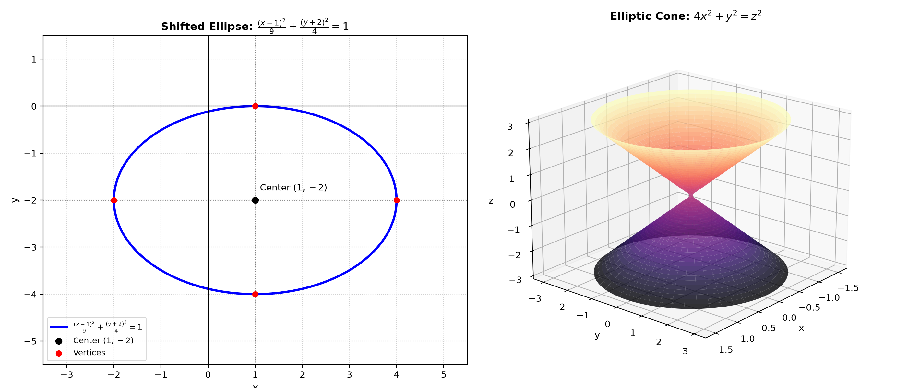

### Problem Statement

Consider the two equations:

$$
4x^2+9y^2-8x+36y+4=0,
$$

$$
4x^2+y^2=z^2.
$$

For the first equation, reduce it to canonical form, recognize the curve, give its most important features, and make a sketch.

For the second equation, do not begin by using a ready-made name for the surface. First describe the cross-sections $z=c$ and the cross-sections by the planes $x=0$ and $y=0$, paying attention to the different scales along the axes. Only then identify the surface and make a sketch.

> **Why this exercise:** tests transfer of the two main mechanisms of the set—moving to canonical form and recognizing an object through cross-sections—without allowing the easiest example to be chosen.

---

### Solution

#### Essential Formulas

1. **Canonical Form of a Translated Ellipse:**

   $$
   \frac{(x - x_0)^2}{a^2} + \frac{(y - y_0)^2}{b^2} = 1
   $$

   Center at $(x_0, y_0)$ with horizontal semiaxis $a$ and vertical semiaxis $b$.

2. **Elliptic Cone:**

   $$
   \frac{x^2}{a^2} + \frac{y^2}{b^2} = \frac{z^2}{c^2}
   $$

   Apex at $(0, 0, 0)$. Horizontal cross-sections $z = c_0$ are ellipses with semiaxes proportional to $|c_0|$, and vertical planes through the origin yield pairs of intersecting straight lines.

3. **Method of Traces (Cross-Sections):**
   A quadric surface is identified geometrically by examining the families of curves produced by setting $z = \mathrm{const}$, $x = 0$, and $y = 0$.

---

**Step 1: First Equation — Reduce $4x^2 + 9y^2 - 8x + 36y + 4 = 0$ to Canonical Form**

* **Group by variables and isolate constant:**

  $$
  (4x^2 - 8x) + (9y^2 + 36y) = -4
  $$

* **Factor out leading coefficients:**

  $$
  4(x^2 - 2x) + 9(y^2 + 4y) = -4
  $$

* **Complete the squares:**
  - $x^2 - 2x = (x - 1)^2 - 1^2 = (x - 1)^2 - 1$
  - $y^2 + 4y = (y + 2)^2 - 2^2 = (y + 2)^2 - 4$

* **Substitute into the equation:**

  $$
  4[(x - 1)^2 - 1] + 9[(y + 2)^2 - 4] = -4
  $$

  $$
  4(x - 1)^2 - 4 + 9(y + 2)^2 - 36 = -4
  $$

  $$
  4(x - 1)^2 + 9(y + 2)^2 - 40 = -4
  $$

* **Add $40$ to both sides:**

  $$
  4(x - 1)^2 + 9(y + 2)^2 = 36
  $$

* **Divide by $36$:**

  $$
  \frac{4(x - 1)^2}{36} + \frac{9(y + 2)^2}{36} = 1
  $$

  $$
  \frac{(x - 1)^2}{9} + \frac{(y + 2)^2}{4} = 1
  $$

  In canonical form:

  $$
  \frac{(x - 1)^2}{3^2} + \frac{(y + 2)^2}{2^2} = 1
  $$

---

**Step 2: First Equation — Features and Geometric Sketch**

* **Type of Curve:** Translated **Ellipse**.
* **Center:**

  $$
  C(x_0, y_0) = (1, \ -2)
  $$

* **Semiaxis Lengths:**
  - Horizontal semi-major axis: $a = \sqrt{9} = 3$
  - Vertical semi-minor axis: $b = \sqrt{4} = 2$
* **Major Vertices:** $(1 \pm 3, -2) \implies V_1(-2, -2)$ and $V_2(4, -2)$
* **Minor Vertices:** $(1, -2 \pm 2) \implies B_1(1, -4)$ and $B_2(1, 0)$
* **Focal Distance and Foci:**

  $$
  c = \sqrt{a^2 - b^2} = \sqrt{9 - 4} = \sqrt{5} \approx 2.24
  $$

  Foci at $F_{1,2}(1 \pm \sqrt{5}, -2)$.
* **Sketch Description:** A closed oval centered at $(1, -2)$, stretched horizontally across a total width of $6$ (from $x = -2$ to $x = 4$) and vertically across a total height of $4$ (from $y = -4$ to $y = 0$).

---

**Step 3: Second Equation — Cross-Section Analysis of $4x^2 + y^2 = z^2$**

1. **Horizontal cross-sections $z = c$:**
   Substitute $z = c$:

   $$
   4x^2 + y^2 = c^2
   $$

   * **For $c = 0$:** $4x^2 + y^2 = 0 \implies x = 0, y = 0$. The cross-section is the **single point** $(0, 0, 0)$.
   * **For $c \neq 0$:** Divide by $c^2$:

     $$
     \frac{4x^2}{c^2} + \frac{y^2}{c^2} = 1 \implies \frac{x^2}{(|c|/2)^2} + \frac{y^2}{|c|^2} = 1
     $$

     This is an **ellipse** in the plane $z = c$.
   * **Scale Difference Along Axes:**
     - Semiaxis along $x$: $a(c) = \frac{|c|}{2}$
     - Semiaxis along $y$: $b(c) = |c|$
     - Because $b(c) = 2a(c)$, the cross-sectional ellipse is twice as long along the $y$-direction as it is along the $x$-direction for every non-zero slice.
     - The semiaxes expand strictly linearly as the altitude $|c|$ increases.

2. **Vertical cross-section $x = 0$ ($yz$-plane trace):**
   Substitute $x = 0$:

   $$
   y^2 = z^2 \implies z^2 - y^2 = 0 \implies (z - y)(z + y) = 0
   $$

   $$
   z = y, \qquad z = -y
   $$

   This is a pair of **intersecting straight lines** through $(0, 0, 0)$ with slopes $\pm 1$ ($45^\circ$).

3. **Vertical cross-section $y = 0$ ($xz$-plane trace):**
   Substitute $y = 0$:

   $$
   4x^2 = z^2 \implies z^2 - 4x^2 = 0 \implies (z - 2x)(z + 2x) = 0
   $$

   $$
   z = 2x, \qquad z = -2x
   $$

   This is a pair of **intersecting straight lines** through $(0, 0, 0)$ with steeper slopes $\pm 2$.

---

**Step 4: Identification of the Surface and Sketch**

* **Identification:**
  - The horizontal slices are ellipses whose dimensions grow linearly with $|z|$.
  - The vertical slices through the origin are straight lines.
  - The apex contracts to a single point at $(0, 0, 0)$.
  - Therefore, the surface is an **Elliptic Cone** (specifically a double cone with an elliptical cross-section).

* **Sketch Description:**
  A double cone with its vertex at the origin $(0, 0, 0)$. It opens upward into the positive half-space ($z > 0$) and downward into the negative half-space ($z < 0$).
  Unlike a standard circular cone, its cross-sections are compressed horizontally: in any slice $z = c$, the width along the $x$-axis is half the width along the $y$-axis.

---

**Step 5: Visual Sketches of the Shifted Ellipse and Elliptic Cone**

The 2D plot of the shifted ellipse and the 3D model of the elliptic cone are shown below:

---

### Final Answer

1. **First Equation ($4x^2 + 9y^2 - 8x + 36y + 4 = 0$):**
   * **Canonical Form:**

     $$
     \frac{(x - 1)^2}{9} + \frac{(y + 2)^2}{4} = 1
     $$

   * **Type:** Ellipse
   * **Features:** Center $C(1, -2)$, horizontal semi-major axis $a = 3$, vertical semi-minor axis $b = 2$, major vertices $(-2, -2)$ and $(4, -2)$.

2. **Second Equation ($4x^2 + y^2 = z^2$):**
   * **Cross-Sections $z = c$:** Ellipses $\frac{x^2}{(|c|/2)^2} + \frac{y^2}{|c|^2} = 1$ with semiaxes $\frac{|c|}{2}$ and $|c|$ (stretched by factor $2$ along $y$); point $(0, 0, 0)$ at $c = 0$.
   * **Cross-Section $x = 0$:** Intersecting lines $z = \pm y$ (slope $\pm 1$).
   * **Cross-Section $y = 0$:** Intersecting lines $z = \pm 2x$ (slope $\pm 2$).
   * **Surface Identity:** **Elliptic Cone** (double cone with elliptical horizontal sections).
